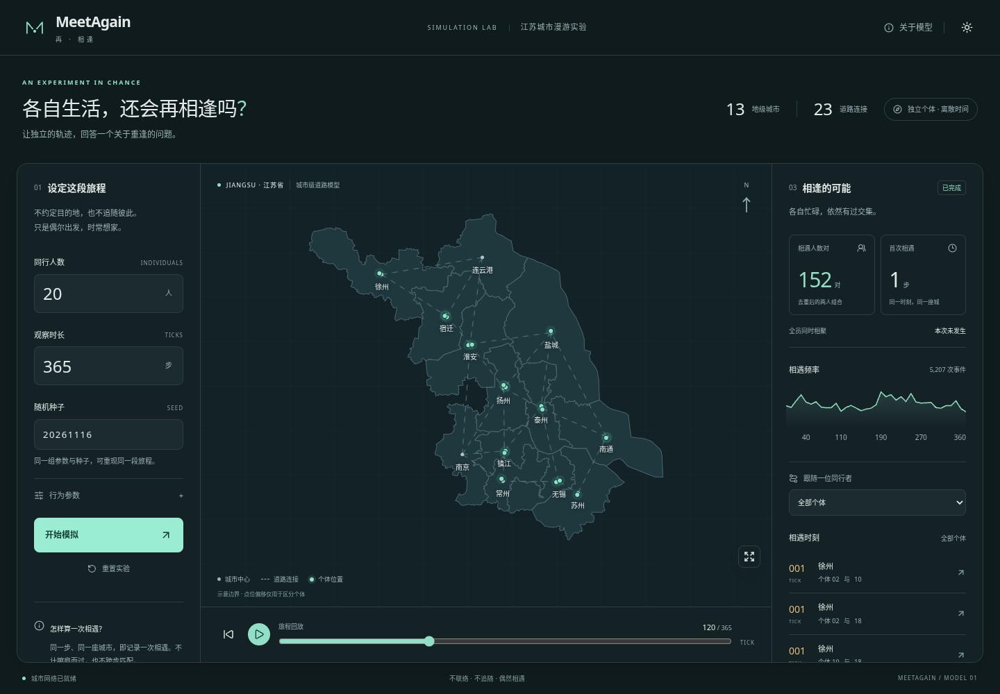

# MeetAgain · 再相逢

**各自生活，还会再相逢吗？** 在江苏 13 座地级市之间，模拟互不协调的个体沿道路图移动，观察他们何时同城相遇。

Rust 模拟引擎与 React 可视化界面分目录开发，最终交付 **一个 Docker 镜像、一个后端进程、一个 HTTP 端口**。后端提供 JSON API，并通过 `tower-http::ServeDir` 托管静态前端。无数据库、地图密钥或运行时外部瓦片依赖。



[浅色界面](docs/screenshots/desktop-light.png) · [手机界面](docs/screenshots/mobile.png) · [API 契约](docs/API.md) · [逐模块交付记录](docs/DELIVERY.md)

## Docker 运行

支持 Linux amd64。三个构建阶段分别使用固定 digest 的 Node slim、Rust slim 和 Debian bookworm-slim；Cargo/npm 锁文件已提交。运行用户为 `65532:65532`，镜像只复制后端二进制和前端 `dist/`。

```sh
docker build --platform=linux/amd64 -t meetagain:latest .
docker run --rm --name meetagain -p 8080:8080 meetagain:latest
```

浏览器访问本机的 8080 端口。默认命令为 `serve --static-dir /app/static`。没有第二个 Web 服务或容器。

在本云环境的 HTTPS 代理下，使用可信 CA 的 BuildKit secret，保持 TLS 校验；CA 不写入镜像：

```sh
docker build --platform=linux/amd64 \
  --secret id=proxy_ca,src=/etc/ssl/certs/ca-certificates.crt \
  -t meetagain:latest .
```

Dockerfile 固定的是依赖和基础镜像输入，不承诺不同构建时间产生相同镜像字节。更新依赖时需重新验证固定种子结果。

## 本地开发

工具版本：Rust **1.90.0**（`rust-toolchain.toml` 自动选择）、Node **24.22.1**、npm 11。使用已有 checkout 即可，不需要额外 worktree。

```sh
npm --prefix frontend ci
npm --prefix frontend run build
cargo run --locked -p meetagain -- serve \
  --address 127.0.0.1:8080 --static-dir frontend/dist
```

后端编译无需前端构建产物。前端修改后重新执行 `npm --prefix frontend run build` 并刷新页面；后端修改后重启服务。两侧仅以 HTTP/JSON 交互，前端不导入后端代码或地理数据文件。

```text
backend/
  data/             GeoJSON、道路连接表、来源与校验记录
  src/graph.rs      图加载、校验、距离、最短返乡路径
  src/simulation.rs agent 移动、轨迹、相遇与汇总
  src/api.rs        API、缓存、分页、静态资源
frontend/
  src/components/   地图、控制面板、回放、结果与折叠布局
  src/api.ts        HTTP 客户端与下载
  src/store.ts      主题、播放和选择状态
  e2e/              浏览器流程、无障碍与 JSON Schema 契约测试
docs/               API Schema、截图、交付证据
```

前端使用 React 19、TypeScript strict、Vite、Tailwind CSS v4、MapLibre GL JS v6、Recharts v3、Zustand 和 TanStack Query。深浅主题可切换；窄屏控制与结果默认折叠；位置过渡 200ms，遵循 `prefers-reduced-motion`。地图 worker 由 Vite 独立打包，不从 CDN 加载。

## 行为模型

1. 每个 agent 独立、均匀地随机选择一个初始城市，同时把它作为 home。
2. 每一步，在 home 时以 `0.10` 概率出行，在外时以 `0.25` 概率出行，否则停留。
3. 决定出行且不在 home 时，以 `0.60` 概率沿加权最短路径向 home 前进一步；否则在邻居中按 `1 / distance_km` 加权选择。
4. 全部 agent 同步更新；不共享位置、不追逐、不协调目的地。每步最多一条边。
5. 同一步、同城市的每一对 agent 产生一个事件。三人同城产生三对；同一对连续同城，每步各记一次。

默认不计初始 tick 0；可以显式开启。不允许跨步容差，也不把边上交叉算作相遇。tick 是决策轮次，不是小时或天；距离不决定在途 tick 数。

图为 **13 节点、23 条加权无向边**。道路表是人工简化的城市间连接，并非真实道路几何提取或导航网络；跨江边表示公路桥梁，不含铁路、轮渡、水路或航空。权重为代表性中心坐标的球面距离近似值，并非实际道路里程。

| 城市 | 邻居 |
|---|---|
| 南京 | 常州、淮安、扬州、镇江 |
| 无锡 | 常州、苏州、泰州 |
| 徐州 | 连云港、宿迁 |
| 常州 | 南京、无锡、镇江 |
| 苏州 | 无锡、南通 |
| 南通 | 苏州、盐城、泰州 |
| 连云港 | 徐州、淮安、宿迁 |
| 淮安 | 南京、连云港、盐城、扬州、宿迁 |
| 盐城 | 南通、淮安、扬州、泰州 |
| 扬州 | 南京、淮安、盐城、镇江、泰州 |
| 镇江 | 南京、常州、扬州、泰州 |
| 泰州 | 无锡、南通、盐城、扬州、镇江 |
| 宿迁 | 徐州、连云港、淮安 |

**边界来源与局限：** 使用 [longwosion/geojson-map-china 的固定提交](https://raw.githubusercontent.com/longwosion/geojson-map-china/0999e0343308443cf9a2a1490c3eaeea576eb181/geometryProvince/32.json)，原始文件及 SHA-256 随项目保存。它是历史简化边界，坐标基准与数据许可未明确注明，不宣称当前官方精度或开放数据许可。仅在其自身坐标框架内显示，不叠加外部底图。[来源记录](backend/data/SOURCES.md) 包含替代来源和说明。个体点位的小偏移仅为区分同城个体。

## 离线 CLI 与可复现性

```sh
cargo run --locked -p meetagain -- graph
cargo run --locked -p meetagain -- simulate \
  --agents 20 --ticks 365 --seed 20261116 > result.json

# 同一镜像也支持无网络的离线模拟，覆盖默认 serve 命令：
docker run --rm --network none meetagain:latest \
  simulate --agents 20 --ticks 365 --seed 20261116 > result.json
```

CLI 可用 `--home-move`、`--away-move`、`--home-return` 调整概率，`--include-tick-zero` 计入初始同城。

ChaCha8、固定 seed、稳定的城市/邻居遍历顺序与锁定依赖实现同代码版本、同配置复现。seed 为十进制 u64 字符串，避免 JavaScript 整数精度损失。Agent ID 从 0 开始，界面显示编号从 01 开始。

输出包含每人的完整 tick 轨迹、家与起终城市、移动次数、访问城市和近似距离，以及全部 `(tick, city_id, agent_ids)` 事件。事件按 tick、城市 ID、agent ID 排序。汇总分别报告至少一对相遇、去重相遇人数对、首次 tick，以及全员同时相聚。API 的运行 ID 为独立随机标识，不属于可复现模拟输出。

固定示例：20 人、365 ticks、seed `20261116`，默认概率得到 **5,207 条事件、152 对去重相遇关系、首次 tick 1、无全员同时相聚**。已验证主机 debug 与容器 release 的离线 JSON 逐字节相同。

有限模拟可以证明某次相遇发生过，不能从零事件推出永不相遇。默认正概率、可停留、独立移动的有限连通 Markov 模型在无限时域以概率 1 到达相聚状态；这不等于现实承诺，也不适用于把某些移动概率设为零后失去遍历性的配置。

## API

| 方法 | 路径 | 用途 |
|---|---|---|
| GET | `/api/health` | 图加载成功后的健康状态 |
| GET | `/api/graph` | 城市、边界、道路、版本与来源 |
| POST | `/api/simulations` | 同步执行模拟，返回 201、汇总和轨迹 |
| GET | `/api/simulations/{id}/encounters` | 分页事件，`limit` 1–1000，`cursor` 不透明 |

```sh
curl -fsS -X POST http://127.0.0.1:8080/api/simulations \
  -H 'Content-Type: application/json' \
  -d '{"agents":20,"ticks":365,"seed":"20261116","movement":{"home_move_probability":0.1,"away_move_probability":0.25,"home_return_probability":0.6},"encounters":{"include_tick_zero":false,"cross_tick_tolerance":0}}'
```

全部字段显式必填，拒绝未知字段。N 为 2–100，ticks 为 1–1000，且最坏成对检查数
`N * (N - 1) / 2 * (ticks + include_tick_zero)` 不超过 500,000。超限返回错误，不截断结果。

单次模拟请求体最多 16 KiB；一次只执行一个模拟任务，并发请求返回 JSON 429。结果缓存在内存中，15 分钟过期，最多保留 4 次，先进先出淘汰；重启丢失。前端提供轨迹和完整结果下载，并提示缓存过期。完整形状及错误码见 [API 契约](docs/API.md) 和 [JSON Schema](docs/api.schema.json)。

## 检查与调试

```sh
bash scripts/check.sh
npm --prefix frontend run format:check

# 先启动上面的服务；也可直接测试已运行的 Docker 容器：
npm --prefix frontend run test:e2e
```

Playwright 优先使用系统 `/usr/bin/chromium`；可用 `CHROMIUM_PATH` 指定浏览器。没有系统浏览器时执行 `cd frontend && npx playwright install chromium`。可用 `BASE_URL` 指向另外的测试地址。

Rust 测试覆盖图验证、连通性、返乡、同步移动、独立重建事件、seed 复现、CLI、API 错误、分页、并发及缓存。浏览器测试覆盖实际渲染的地图、完整模拟/下载、主题、播放、筛选、窄屏、减少动画与自动化 WCAG AA 检查。Ajv 校验真实 HTTP 响应与已确认 Schema。

`RUST_LOG=meetagain=debug,tower_http=debug` 开启服务日志，写入 stderr，不污染 CLI JSON。`cargo run -- --help` 查看全部命令。服务响应 SIGINT/SIGTERM，可正常停止。
